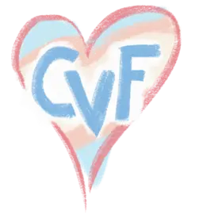

<table><tr><td></td><td><h1>CVF Open Access Paper Stamping Pipeline</h1></td></tr></table>

## Overview

This is `cvf-openaccess-publishing-pipeline`, a Python CLI tool that processes PDF files for the [CVF Open Access Archive](https://openaccess.thecvf.com/menu)

## Invocation

```shell
# For help:
$ uv run cvf-openaccess-publishing-pipeline --help
$ uv run cvf-openaccess-publishing-pipeline run --help

# Stamp the workshop track:
$ uv run cvf-openaccess-publishing-pipeline run /path/to/cvpr2026-workshops.toml
$ uv run cvf-openaccess-publishing-pipeline run /path/to/cvpr2026-workshops.toml -n # dry run

# First 10 papers:
$ uv run cvf-openaccess-publishing-pipeline run /path/to/cvpr2026-workshops.toml 1-10

# Print as JSON:
$ uv run cvf-openaccess-publishing-pipeline show-json /path/to/cvpr2026-workshops.toml
$ uv run cvf-openaccess-publishing-pipeline show-json /path/to/cvpr2026-workshops.toml | jq .title
$ uv run cvf-openaccess-publishing-pipeline show-json /path/to/cvpr2026-workshops.toml 1-10 | jless # accepts slices

# Generate QA reports:
$ uv run cvf-openaccess-publishing-pipeline report /path/to/cvpr2026-workshops.toml

# Start IPython shell with paper loaded for debugging:
$ uv run cvf-openaccess-publishing-pipeline shell /path/to/cvpr2026-workshops.toml
```

### Inputs for each track
You must prepare:
1. `config.toml`, a handwritten configuration file
2. **A directory full of PDF files** from OpenReview which have been prepared by the IEEE Computer Society's Conference Publishing Services (CPS) division
3. **A spreadsheet** with metadata about the papers from CPS

### Outputs for each track
This tool produces:
1. A directory of PDF files
2. `papers.csv` containing metadata about the papers
3. `report.html`, a report of thumbnails of every processed paper for manual review

Artifacts 1 and 2 are sent to the CVF Open Access website admin team to be uploaded to the Open Access website. Artifact 3 should be inspected closely by the person running this tool to ensure that the PDF files have been processed correctly.

### What this tool does
- Reads the conference information, spreadsheet URL, etc from `config.toml`
- Reads title, authors, abstract, first/last page, etc. from each row of the spreadsheet
- **Verify** the following invariants for the input:
  - Every paper listed in the spreadsheet has a corresponding PDF file in the input directory
  - Every PDF file in the input directory has a corresponding row in the spreadsheet
  - Output filenames generated from the spreadsheet metadata are unique and don't collide with each other
- For each paper:
  - **Apply PDF metadata**: set `dc:title` to the paper title, `dc:creator` to the list of paper authors, and `dc:description` to the long name of the conference
  - **Verify page count** matches the spreadsheet
  - **Stamp the CVF Open Access banner** on the first page
  - **Stamp page numbers:** Apply heuristics to guess whether the author forgot to turn off page numbering in their PDF, and if so, apply a stamp to the bottom of each page with the correct page number from the spreadsheet.
  - **Strip author-applied review markup annotations** (eg. from Preview.app)
  - **Write** the processed PDF to the output directory with a suitable output filename
- **Generate output spreadsheet**, saved to `papers.csv`
- **Generate thumbnail report** for manual review, saved to `report.html`
- **Verify** the following invariants for the output:
  - `papers.csv` must exist
  - All output files exist
  - All output files have the same number of pages as on the spreadsheet

### What to do next

- Zip up the entire output directory and send it to the CVF Open Access website admin team.

## Configuration


### Preparing input files
Example directory tree for CVPR 2026, which has "main", "findings", and "workshops" tracks:
```
Google Drive/My Drive/Areas/CVF Open Access Proceedings/CVPR 2026/
│   
│   Config files for the three tracks:
│   
├── cvpr2026-findings.toml
├── cvpr2026-main.toml
├── cvpr2026-workshops.toml
│   
│   Input papers from IEEE CPS:
│   
├── Files for CVF - CVPR, CVPRW, CVPRF
│   ├── CVPR 2026 - Main Conference
│   │   ├── CVPR 2026 - Metadata for CVF - 260501.gsheet
│   │   ├── CVPR 2026 - Paper PDF Files
│   │   │   ├── 30593.pdf
│   │   │   ├── 30595.pdf
│   │   │   ├── 30599.pdf
│   │   │   │    ⋮
│   │   │   └── 46780.pdf
│   │   └── CVPR 2026 - Supplemental Files
│   │       ├── 30593_supp_1.zip
│   │       ├── 30595_supp_1.pdf
│   │       ├── 30599_supp_1.pdf
│   │       │    ⋮
│   │       └── 46778_supp_1.zip
│   │  
│   ├── CVPRF 2026 - Findings
│   │   ├── CVPRF 2026 - Metadata for CVF - 260508.gsheet
│   │   ├── CVPRF 2026 - Paper PDF Files
│   │   │   ├── 30623.pdf
│   │   │   ├── 30627.pdf
│   │   │   ├── 30629.pdf
│   │   │   │    ⋮
│   │   │   └── 46728.pdf
│   │   └── CVPRF 2026 - Supplemental Files
│   │       ├── 30623_supp_1.zip
│   │       ├── 30627_supp_1.pdf
│   │       ├── 30629_supp_1.pdf
│   │       │    ⋮
│   │       └── 46728_supp_1.zip
│   │  
│   └── CVPRW 2026 - Workshops
│       ├── 5 25 2026 - CVPRW 2026, minus Missing Supps - Metadata for CVF - 260512.gsheet
│       ├── CVPRW 2026 - Metadata for CVF - 260512.gsheet
│       ├── CVPRW 2026 - Metadata for CVF - 260527.gsheet
│       ├── CVPRW 2026 - Paper PDF Files
│       │   ├── 3DMV-10.pdf
│       │   ├── 3DMV-11.pdf
│       │   ├── 3DMV-12.pdf
│       │   │    ⋮
│       │   ├── 6thAdvML@CV-1.pdf
│       │   ├── 6thAdvML@CV-12.pdf
│       │   ├── 6thAdvML@CV-15.pdf
│       │   │    ⋮
│       │   ├── A2A-MML-13.pdf
│       │   ├── A2A-MML-18.pdf
│       │   ├── A2A-MML-19.pdf
│       │   │    ⋮
│       │   ├── A4VM-13.pdf
│       │   ├── A4VM-16.pdf
│       │   ├── A4VM-18.pdf
│       │   │    ⋮
│       │   ├── ABAW-12.pdf
│       │   ├── ABAW-15.pdf
│       │   ├── ABAW-18.pdf
│       │   │    ⋮
│       │   └── XAI4CV-4.pdf
│       └── CVPRW 2026 - Supplemental Files
│           ├── 3DMV-10_supp_1.pdf
│           ├── 3DMV-11_supp_1.pdf
│           ├── 3DMV-16_supp_1.pdf
│           │    ⋮
│           ├── 6thAdvML@CV-1_supp_1.pdf
│           ├── 6thAdvML@CV-2_supp_1.pdf
│           ├── 6thAdvML@CV-4_supp_1.pdf
│           │    ⋮
│           ├── A2A-MML-13_supp_1.pdf
│           ├── A2A-MML-20_supp_1.pdf
│           │    ⋮
│           └── XAI4CV-4_supp_1.pdf
│   
│   Outputs written by this tool:
│   
├── output-findings-20260516
│   ├── papers.csv
│   ├── Abdelgawad_Online_Interpretable_Matrix_Decomposition_for_Large-Scale_Streaming_Data_CVPRF_2026_paper.pdf
│   ├── Abid_Gazemo_Mimicking_Human_Saccades_via_Foveal-Peripheral_Feature_Modeling_for_Lightweight_CVPRF_2026_paper.pdf
│   ├── Aboukhadra_GHOST_Fast_Category-Agnostic_Hand-Object_Interaction_Reconstruction_from_RGB_Videos_Using_CVPRF_2026_paper.pdf
│   │    ⋮
│   └── Zuo_Channel_Correlation_Loss_for_Binary_Neural_Networks_CVPRF_2026_paper.pdf
├── output-main-20260516
│   ├── papers.csv
│   ├── Abdal_Visual_Personalization_Turing_Test_CVPR_2026_paper.pdf
│   ├── Abdelfattah_OSMO_Open-vocabulary_Self-eMOtion_Tracking_CVPR_2026_paper.pdf
│   ├── Abousamra_TopoSlide_Topologically-Informed_Histopathology_Whole_Slide_Image_Representation_Learning_CVPR_2026_paper.pdf
│   │    ⋮
│   └── Zuo_SketchRevive_Fine-Grained_Pixel-to-Vector_Sketch_Completion_with_Diffusion-Prior-Guided_Multimodal_LLMs_CVPR_2026_paper.pdf
├── output-workshops-20260516
│   ├── papers.csv
│   ├── w1
│   │   ├── Gogawale_Bag_of_Bags_Adaptive_Visual_Vocabularies_for_Genizah_Join_Image_CVPRW_2026_paper.pdf
│   │   └── Yin_Documentation_Infrastructure_and_Ethical_Challenges_in_Spatial_AI_for_Cultural_CVPRW_2026_paper.pdf
│   ├── w10
│   │   ├── Bhatia_Li-AutoFlow_Autoregressive_Flow_Matching_for_Continuous_AV_Scene_Prediction_CVPRW_2026_paper.pdf
│   │   ├── Chahe_Policy-Guided_World_Model_Planning_for_Language-Conditioned_Visual_Navigation_CVPRW_2026_paper.pdf
│   │   ├── Chen_Intelligent_Robot_Manipulation_Requires_Self-Directed_Learning_CVPRW_2026_paper.pdf
│   │   │    ⋮
│   │   └── Yaman_Remedying_the_Curse_of_Autonomous_Driving_VLM_Driven_Training-Free_Framework_CVPRW_2026_paper.pdf
│   ├── w11
│   │   ├── Chiu_Edge-Efficient_Vision-Language_Models_for_Autonomous_Driving_Using_Distillation_and_RAG-Based_CVPRW_2026_paper.pdf
│   │   ├── Haklidir_When_Does_Adaptive_Guidance_Help_Belief-Aware_Privileged_Distillation_for_Autonomous_CVPRW_2026_paper.pdf
│   │   ├── Lengyel_CCLSTM_Coupled_Convolutional_Long-Short_Term_Memory_Network_for_Occupancy_Flow_CVPRW_2026_paper.pdf
│   │   │    ⋮
│   │   └── Yong_Localization-Guided_Foreground_Augmentation_in_Autonomous_Driving_CVPRW_2026_paper.pdf
│   ├── w12
│   │   ├── Holzemann_SCAR_Satellite_Imagery-Based_Calibration_for_Aerial_Recordings_CVPRW_2026_paper.pdf
│   │   ├── Jozsa_RF-Loc_Robust_Visual-Radio_Frequency_Localization_via_Hierarchical_Point_Cloud_Registration_CVPRW_2026_paper.pdf
│   │   ├── Mandal_VGGT-SLAM_CVPRW_2026_paper.pdf
│   │   └── Safavigerdini_Gram-Schmidt_Feature_Reduction_for_Local_Feature_Descriptor_Compression_CVPRW_2026_paper.pdf
│   │    ⋮
│   │    ⋮
│   │    ⋮
│   └── w97
│       ├── Gui_Object-Aware_4D_Human_Motion_Generation_CVPRW_2026_paper.pdf
│       ├── hari_SimScene_Automated_Photorealistic_Scene_Reconstruction_for_Geographically_Scalable_Physical_AI_CVPRW_2026_paper.pdf
│       ├── Karhade_Any4D_Unified_Feed-Forward_Metric_4D_Reconstruction_CVPRW_2026_paper.pdf
│       │    ⋮
│       └── Zhang_3D_Gaussian_Splatting_for_Efficient_Retrospective_Dynamic_Scene_Novel_View_CVPRW_2026_paper.pdf
└── qa-reports
    ├── findings-20260516-a-00001-of-00001.html
    ├── findings-20260516-a-00001-of-00004.html
    ├── findings-20260516-a-00002-of-00004.html
    ├── findings-20260516-a-00003-of-00004.html
    ├── findings-20260516-a-00004-of-00004.html
    ├── main-20260516-a-00001-of-00014.html
    ├── main-20260516-a-00002-of-00014.html
    ├── main-20260516-a-00003-of-00014.html
    ├── main-20260516-a-00004-of-00014.html
    │    ⋮
    ├── main-20260516-a-00014-of-00014.html
    ├── workshops-20260516-a-00001-of-00001.html
    ├── workshops-20260516-a-00001-of-00004.html
    ├── workshops-20260516-a-00002-of-00004.html
    │    ⋮
    └── workshops-20260527-a-00004-of-00004.html
```


### Example configuration file for CVPR 2026 main track (`cvpr2026-main.toml`):
```toml
acronym            = "CVPR"
long_name          = "IEEE Conference on Computer Vision and Pattern Recognition"
year               = 2026

input_path         = "Files for CVF - CVPR, CVPRW, CVPRF/CVPR 2026 - Main Conference/CVPR 2026 - Paper PDF Files/"
output_path        = "output-main-20260516/"
report_output_path = "qa-reports/main-20260516-a.html"

[banner]
text = """
This CVPR paper is the Open Access version, provided by the Computer Vision Foundation.
Except for this watermark, it is identical to the accepted version;
the final published version of the proceedings is available on IEEE Xplore.
"""

[spreadsheet]
url = "https://docs.google.com/spreadsheets/d/.../export?format=csv"
# The above Google Sheets doc is shared to the public ("Anyone with the link can access").
# We manually edited the URL to add `/export?format=csv` at the end.
# This URL links to a CSV export of the spreadsheet, which is what
# this tool expects as input.

# The list of column names (Row 1 in the google spreadsheet)
# Sometimes these change from year to year
[spreadsheet.columns]
title                 = "Title (Corrected)"
abstract              = "Abstract (Cleaned)"
authors               = "Authors (Corrected)"
authors_separator     = ","
input_filename        = "Camera-Ready File (Corrected)"
supplemental_filename = "Supplemental File (Corrected)"
first_page            = "First Page"
last_page             = "Last Page"
```


### Example configuration file for CVPR 2026 workshop track (`cvpr2026-workshops.toml`)
```toml
acronym            = "CVPRW"
long_name          = "IEEE Conference on Computer Vision and Pattern Recognition Workshops"
year               = 2026
input_path         = "Files for CVF - CVPR, CVPRW, CVPRF/CVPRW 2026 - Workshops/CVPRW 2026 - Paper PDF Files/"
output_path        = "output-workshops-20260527/"
zip_output_path    = "output-workshops-20260527.zip"
report_output_path = "qa-reports/workshops-20260527-a.html"

[banner]
text = """
This CVPR Workshop paper is the Open Access version, provided by the Computer Vision
Foundation. Except for this watermark, it is identical to the accepted version;
the final published version of the proceedings is available on IEEE Xplore.
"""

[spreadsheet]
url = "https://docs.google.com/spreadsheets/d/.../export?format=csv"

[spreadsheet.columns]
title                  = "Title (Corrected)"
abstract               = "Abstract (Cleaned)"
authors                = "Authors (Corrected)"
authors_separator      = ","
input_filename         = "Camera-Ready File (Corrected)"
supplemental_filename  = "Supplemental File (Corrected)"
first_page             = "First Page"
last_page              = "Last Page"
output_filename_prefix = "Output Filename Prefix"
```
Note the followng differences between the main and workshop track:
- The `acronym` and `long_name` fields now mention workshops
- The `input_path` field has been updated to point to the correct directory of PDF files
- All three `output_path`s have been changed
- The banner text refers to "CVPR Workshop paper" instead of just "CVPR paper", and has been wrapped differently
- The `[spreadsheet].url` points to the workshop spreadsheet
- There's an `output_filename_prefix` field in the `[spreadsheet.columns]` section. The spreadsheet contains cells like `w1/`, `w3/`, `w5/`, etc., which are used as prefixes for the output filenames to ensure that they are unique and to group papers by workshop in the output directory. The tool will insert this prefix at the beginning of each output filename, before the paper title and conference acronym. For example, if the original output filename would have been `Gogawale_Bag_of_Bags_Adaptive_Visual_Vocabularies_for_Genizah_Join_Image_CVPRW_2026_paper.pdf`, and the `output_filename_prefix` value for that row is `w1/`, then the final output filename will be `w1/Gogawale_Bag_of_Bags_Adaptive_Visual_Vocabularies_for_Genizah_Join_Image_CVPRW_2026_paper.pdf`.


## CVF / IEEE organizational structure

This tool manages all of the blue parts of the following flowchart:

![Flowchart showing][Flowchart]


[CVF image]: assets/cvf-logo.webp

[Flowchart]: assets/flowchart.webp
